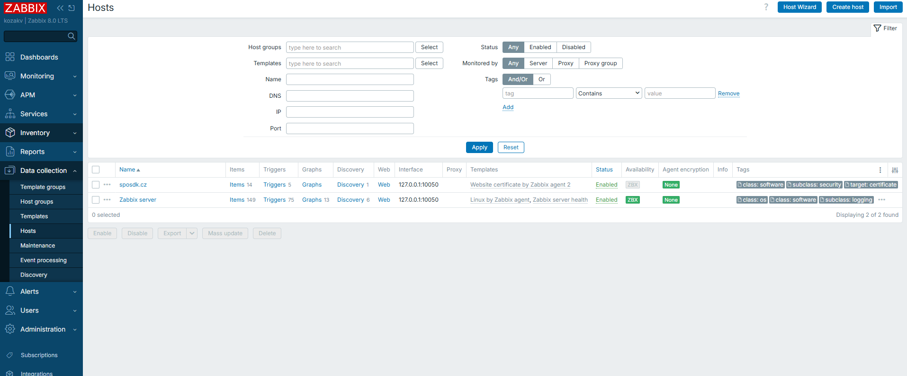

# Automatická instalace Zabbixu 8.0 LTS na Debian 13

## 1. Popis projektu

Projekt vznikl v rámci předmětu **Operační systémy (OSY)**. Jeho cílem je automatizovat vytvoření virtuálního serveru s operačním systémem Debian 13 a následnou instalaci a konfiguraci monitorovacího systému Zabbix 8.0 LTS.

Celé nasazení probíhá pomocí nástroje Vagrant a virtualizačního prostředí VirtualBox. Po spuštění projektu se automaticky nainstalují potřebné služby, vytvoří databáze a nakonfiguruje webové rozhraní Zabbixu.

## 2. Použité technologie

- **Debian 13** – operační systém virtuálního serveru
- **Zabbix 8.0 LTS** – monitorovací systém
- **Vagrant** – automatizace vytvoření a konfigurace virtuálního stroje
- **VirtualBox** – virtualizační prostředí
- **MariaDB** – databázový server
- **Apache** – webový server
- **Zabbix Agent 2** – sběr monitorovacích údajů

## 3. Struktura projektu

```text
├── Images/                 # Screenshoty projektu
├── scripts/                # Instalační a konfigurační skripty
├── Vagrant/                # Konfigurační soubory
├── Zabbix/
│   ├── export/             # Export konfigurace hostitele
│   └── Zabbix_Documentation_8.0.en.pdf
├── .gitignore
├── Vagrantfile
├── README.md
└── LICENSE
```

## 4. Parametry virtuálního stroje

| Parametr | Hodnota |
|---|---|
| Operační systém | Debian 13 |
| Procesory | 2 |
| Operační paměť | 2048 MB |
| Název virtuálního stroje | kozakv-zabbix |
| Webové rozhraní | Port 8080 |
| SSH | Port 2222 |
| Časová zóna | Europe/Prague |

## 5. Spuštění projektu

Pro spuštění je potřeba mít nainstalovaný **VirtualBox** a **Vagrant**.

Nejprve naklonujeme repozitář a přejdeme do jeho složky:

```powershell
git clone https://github.com/sposdknl/v0jt4-osy-2026-zbx8-inst.git
cd v0jt4-osy-2026-zbx8-inst
```

Před spuštěním nastavíme hesla potřebná pro instalaci:

```powershell
$env:ZBX_DB_PASSWORD = "VLASTNI_HESLO_DATABAZE"
$env:ZBX_ADMIN_PASSWORD = "VLASTNI_HESLO_ADMINA"
```

Heslo databáze může obsahovat pouze písmena a číslice.

Samotnou instalaci spustíme příkazem:

```powershell
vagrant up
```

Vagrant vytvoří virtuální stroj a automaticky provede instalaci a konfiguraci potřebných služeb.

## 6. Přístup do Zabbixu

Po dokončení instalace je webové rozhraní dostupné na adrese:

**http://127.0.0.1:8080/zabbix**

Přihlašovací údaje:

- Uživatelské jméno: `Admin`
- Heslo: hodnota nastavená v `ZBX_ADMIN_PASSWORD` při první instalaci

Hesla nejsou součástí repozitáře a je nutné je nastavit samostatně.

## 7. Monitorování

Projekt umožňuje monitorování virtuálního serveru Debian 13 prostřednictvím Zabbix Agent 2. V rozhraní Zabbixu lze sledovat dostupnost serveru, systémové informace a další získávané hodnoty.

Součástí projektu je také import připravené konfigurace hostitele `sposdk.cz`, která slouží ke sledování platnosti SSL/TLS certifikátu.

Import konfigurace lze spustit příkazem:

```powershell
vagrant provision --provision-with import-host
```

## 8. Ukázka monitorování

Následující obrázek zachycuje monitorování domény `sposdk.cz` v systému Zabbix.



## 9. Závěr

Výsledkem projektu je automatizované prostředí se systémem Debian 13 a monitorovacím systémem Zabbix 8.0 LTS. Instalace a základní konfigurace probíhá bez nutnosti ručního nastavování jednotlivých služeb. Projekt je možné opakovaně nasadit pomocí Vagrantu.